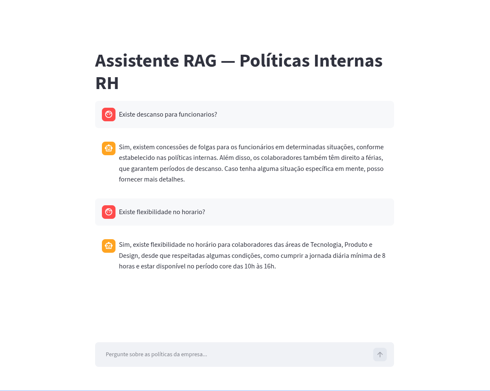

# My FAISS RAG

An HR internal-policy RAG assistant built with Streamlit, LangChain (LCEL), FAISS and OpenAI.
Ask questions in Brazilian Portuguese and get answers grounded only in the company's HR policy PDF.

## Quick start

```bash
mise install                        # Python 3.12 + uv
uv sync                             # create .venv and install dependencies
cp .env.example .env.local          # then set OPENAI_API_KEY in it
cp /path/to/your-policy.pdf data/document.pdf
uv run streamlit run src/my_faiss_rag/app.py
```

The step-by-step version follows.

## Prerequisites

- [mise](https://mise.jdx.dev/getting-started.html): installs the pinned Python 3.12 and
  [uv](https://docs.astral.sh/uv/) (versions in `mise.toml`). After installing it, activate it in
  your shell (e.g. `eval "$(mise activate zsh)"` in `~/.zshrc`) so `python` and `uv` resolve to the
  pinned versions inside this folder.
- An OpenAI API key.
- The HR policy PDF used as the knowledge base.

## Initializing the project

Run these once, from the project root, after cloning:

```bash
# 1. Install the pinned Python and uv
mise install

# 2. Create .venv and install the app and dev dependencies exactly as locked in uv.lock
uv sync

# 3. Enable the git hooks (ruff, mypy, whitespace checks on every commit)
uv run pre-commit install

# 4. Create your local env file
cp .env.example .env.local
```

Edit `.env.local` and set your key:

```
OPENAI_API_KEY=sk-...
```

`.env.local` is ignored by git, so don't commit your key anywhere else.

Finally, put the knowledge-base PDF at `data/document.pdf`. The `data/` folder is ignored by git,
so the PDF has to be added by hand on every machine.

## Starting the app

```bash
uv run streamlit run src/my_faiss_rag/app.py
```

The app opens at http://localhost:8501. Stop it with `Ctrl+C`.

- `uv run` uses the project's `.venv` automatically, so you don't need to activate it.
- The first question takes longer: the app embeds the PDF with OpenAI and builds the FAISS index.
  The index is then cached until the server restarts.
- To use another port, add `--server.port 8502`.
- If you change the PDF, restart the server to rebuild the index.

**Troubleshooting**
- *Authentication / API key error:* check `OPENAI_API_KEY` in `.env.local` (at the project root).
- *File not found for `document.pdf`:* the PDF must be at exactly `data/document.pdf`.
- *`uv: command not found`:* run `mise install` and make sure mise is activated in your shell.

## Development

| Task         | Command                             |
| ------------ | ----------------------------------- |
| Format       | `uv run ruff format .`              |
| Lint         | `uv run ruff check --fix .`         |
| Type check   | `uv run mypy`                       |
| Tests        | `uv run pytest`                     |
| All hooks    | `uv run pre-commit run --all-files` |
| Add a dep    | `uv add <pkg>` / `uv add --dev <pkg>` |

Tests run offline: OpenAI embeddings and the chat model are replaced with LangChain fakes, and the
Streamlit UI is tested with `AppTest`. The run fails if coverage drops below 90%.

All tool settings live in `pyproject.toml`.

## Project structure

```
.
├── src/my_faiss_rag/
│   ├── app.py          # Streamlit UI (entry point)
│   ├── chain.py        # FAISS vector store + RAG chain
│   ├── ingestion.py    # PDF loading and chunking
│   └── config.py       # Paths, models and settings
├── tests/              # pytest suite
├── data/               # Knowledge-base PDF (git-ignored)
├── .github/            # README assets (screenshot)
├── .env.example        # Environment variables template
├── AGENTS.md           # Guidance for AI coding agents
├── LICENSE             # MIT license
├── CLAUDE.md           # Claude Code entry point (imports AGENTS.md)
├── mise.toml           # Python and uv versions
├── pyproject.toml      # Dependencies and tool configs
└── uv.lock             # Locked dependency versions
```

## Frontend



The whole UI is a single [Streamlit](https://streamlit.io) script, `src/my_faiss_rag/app.py`, written in
Python. There's no HTML, CSS or JavaScript to maintain, and no separate frontend build. The page in
the screenshot is made only of native Streamlit elements, using the default theme:

| What you see                         | Streamlit feature                                         |
| ------------------------------------ | --------------------------------------------------------- |
| Page heading                         | `st.title`                                                |
| User and assistant bubbles + avatars | `st.chat_message("user")` / `st.chat_message("assistant")` |
| Message text                         | `st.write`                                                |
| Input pinned to the bottom of the page | `st.chat_input(..., key="chat_input")`                  |
| "Buscando..." while the answer loads | `st.spinner`                                              |

How it behaves:

- **Rerun model.** Streamlit reruns the script from top to bottom on every interaction. Sending a
  message triggers a rerun, which redraws the page.
- **Chat history.** Messages are kept in `st.session_state["messages"]` (one list per browser
  session), and the whole conversation is redrawn on each rerun.
- **One index per server.** `get_chain()` is decorated with `st.cache_resource`, so the PDF is
  embedded and indexed in FAISS only once, on the first question ("Indexando o documento...").
  Later questions and other users reuse the same chain.
- **UI text** (title, placeholder, spinners) is in Brazilian Portuguese, like the answers.
- **Tests.** The UI is tested headlessly with Streamlit's `AppTest` (`tests/test_app.py`), with a
  fake chain, so no browser or OpenAI key is needed.

---

Released in 2026.

By [Victor B. Fiamoncini](https://github.com/Victor-Fiamoncini) ☕️
